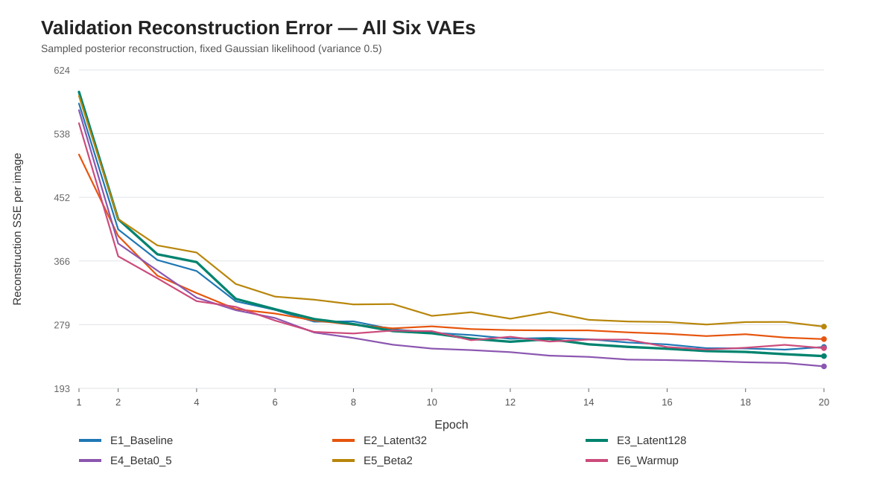
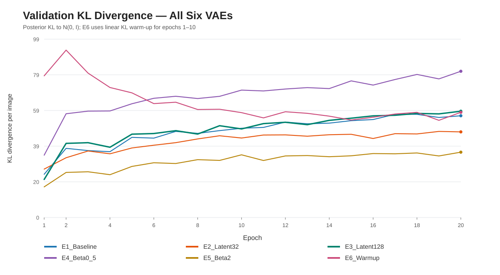
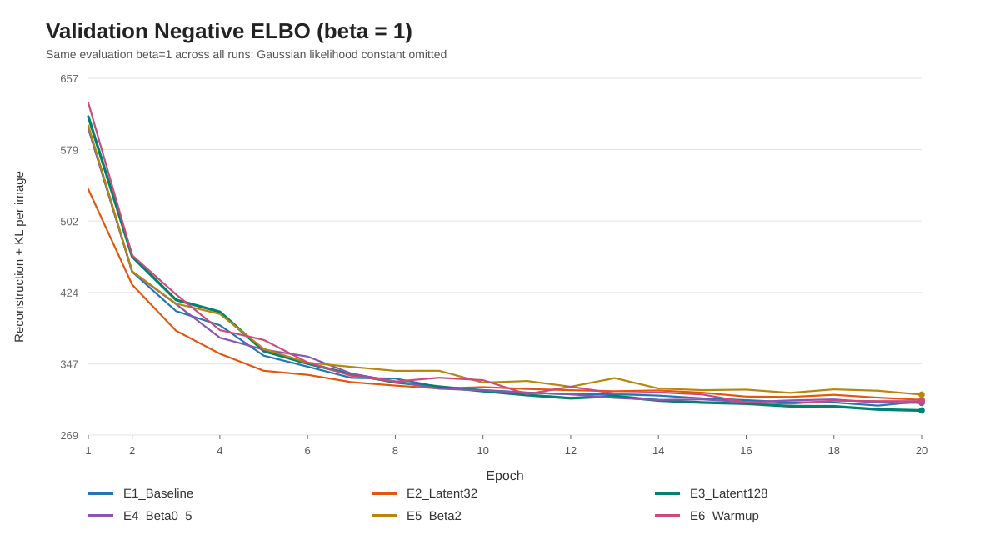

# Learning ImageNet Representations with Variational Autoencoders and GANs

**Team T24 — CSE473 Computational Intelligence**

Private team repository for the full project. The **six-run VAE study is complete**. GAN/VAE-GAN, downstream classification, latent-space analyses and full report are separate team work.

## VAE study deliverables

| Location | Contents |
|---|---|
| [`vae.py`](vae.py) | PyTorch convolutional encoder, reparameterization, decoder and beta-VAE loss |
| [`train_vae.py`](train_vae.py) | Original standalone 20-epoch baseline training script |
| [`run_vae_study.py`](run_vae_study.py) | Standalone runner recreating the six study configurations; supports resume; **newly reconstructed and not yet end-to-end tested** |
| [`plot_vae_study.py`](plot_vae_study.py) | Regenerate study curves from committed JSON histories |
| [`results/predictions.md`](results/predictions.md) | Hypotheses for E2–E6 (committed before those runs); note E1 had already been completed |
| [`results/analysis_report.md`](results/analysis_report.md) | Full comparison, interpretations, selection rationale, posterior-collapse discussion and methodology limitations |
| [`results/experiment_comparison.csv`](results/experiment_comparison.csv) | Machine-readable six-run metrics |
| [`results/plots/`](results/plots/) | Validation reconstruction, KL and negative ELBO figures |
| `results/E1_Baseline/` through `results/E6_Warmup/` | Each experiment's **20-epoch** `history.json` and `summary.json` |
| [`results/baseline/`](results/baseline/) | Separate original baseline evaluation and run metadata |

## Experimental setup

Images: **64×64 RGB**, with **11,529 training and 1,281 validation images** from a 10-class ImageNet subset. Encoder output-channel progression: **32 → 64 → 128 → 256** with four stride-2 convolutions. The encoder returns a mean and log-variance for a Gaussian approximate posterior, sampled using `z = mean + exp(0.5 * logvar) * epsilon`; the decoder reconstructs the input via a linear layer and four transposed convolutions.

Loss = **per-image sum of squared pixel errors averaged over a batch** + training beta × **KL(q(z|x) || N(0,I))**. The squared-error term corresponds to a fixed-variance Gaussian negative log likelihood up to an additive constant. When comparing runs, **validation negative ELBO is always evaluated with beta=1**, even if training beta differs.

Shared settings: 20 epochs, batch 128, Adam learning rate 0.001, random seed 42. All runs are initialized independently; each experiment changes one factor from E1.

| Run | Latent dim | Training beta | KL warm-up |
|---|---:|---:|---|
| E1_Baseline | 64 | 1 | Off |
| E2_Latent32 | 32 | 1 | Off |
| E3_Latent128 | 128 | 1 | Off |
| E4_Beta0_5 | 64 | 0.5 | Off |
| E5_Beta2 | 64 | 2 | Off |
| E6_Warmup | 64 | 1 | On: increase from 0.1 to 1 over 10 epochs |

## Completed results — epoch 20

| Run | Validation pixel MSE ↓ | KL | Validation negative ELBO (beta=1) ↓ | Active units |
|---|---:|---:|---:|---:|
| E1 | 0.018563 | 56.25 | 305.57 | 61/64 |
| E2 | 0.020070 | 47.33 | 307.25 | 32/32 |
| **E3** | **0.017414** | **58.75** | **295.68** | **124/128** |
| E4 | **0.017229** | 80.84 | 303.89 | 64/64 |
| E5 | 0.020310 | 36.12 | 312.94 | 64/64 |
| E6 | 0.018536 | 58.15 | 305.86 | 60/64 |

**Selected for further study: E3_Latent128**, since it has the lowest validation negative ELBO at the common fixed 20-epoch budget. **E4** has the lowest pixel reconstruction MSE but a higher KL, resulting in a worse negative ELBO under beta=1. E6 KL warm-up did not materially improve results over E1. No run showed evidence of **complete** posterior collapse based on KL and active-unit counts, although partial latent underutilization is still possible.

For timing, peak GPU memory, numeric precision, figures and limitations, see [the full study report](results/analysis_report.md).

### Validation curves







## Model checkpoints and data — Google Drive

Large data and model weights remain on Google Drive, **not** Git. Team members must have appropriate Drive sharing permissions.

- [T24 VAE Results folder](https://drive.google.com/drive/folders/13Dd6eMQw5WgDvtS75a2h4Qf71xs8T7A5)
- [Six-experiment checkpoints folder](https://drive.google.com/drive/folders/11uIykXqDXNIukItKjxJA81N2B253q0rB)
- [Selected E3 epoch-20 checkpoint](https://drive.google.com/file/d/1RvYug7dPSXC1YuVNoEC67lg2w_yTJDc7/view)
- [Original baseline checkpoint](https://drive.google.com/file/d/1US8y1jP3kFUNhqHgGHwFSbYWOc4yca17/view)
- [Original baseline reconstruction example grid](https://drive.google.com/file/d/149Mz3JF7Cu2_PbdFMrjzBeL95ZPmXhiS/view)

For the selected model, instantiate `VAE(latent_dim=128)`, load the E3 checkpoint using `torch.load(..., map_location="cpu", weights_only=True)`, then load `checkpoint["model_state"]`.

## Reproduction

**Important provenance:** the six archived run histories originated from the team's Google Colab notebook. The independently reconstructed `run_vae_study.py` follows the documented architecture, data processing, training/evaluation loop and checkpoint schema, **but has not yet been executed end-to-end**, and it is **not a substitute for committing the original Colab notebook**. Keep experiment history and predictions in Git rather than replacing them with fresh results.

In Colab, mount Drive, install or import PyTorch and NumPy, then from a checkout of this repository run:

```bash
python run_vae_study.py --run E3_Latent128 \
    --data-dir /content/drive/MyDrive/T24_Dataset \
    --output-dir /content/drive/MyDrive/T24_VAE_Results/VAE_6_Experiments
```

**Warning:** if the checkpoint at that output path already exists, the script resumes it or reports it complete; choose a **new output directory** for an independent retraining. The input study expects raw pixel values in 0–255 and normalizes once. If dataset or results folders were moved, change the CLI paths. To regenerate plots from existing histories:

```bash
python plot_vae_study.py
```

The original `train_vae.py` is a separate baseline-only script; its hardcoded Colab paths may need updating.

## Integrity and study limitations

- E1 was **trained before** hypotheses were recorded. Do not claim E1 was pre-registered. E2–E6 predictions were committed before those runs.
- The original baseline is a **different training run** from E1. Its evaluation and checkpoint SHA-256 are in `results/baseline/`; do not mix these two baseline metrics.
- The negative ELBO uses a stochastic posterior sample and may vary slightly between evaluation calls; pixel MSE is calculated using `decoder(posterior_mean)`.
- The logged runtime is the sum of epoch training + validation time (not session wall clock); memory is peak **allocated** CUDA memory in MiB, not reserved or physical GPU occupancy.
- Single training seed, finite training duration and stochastic validation limit statistical certainty. Final best-model claims should be qualified until additional controlled validation.
- Do not use test data for tuning or run selection. Save test evaluation for the final locked model.
- The team should archive the exact **`.ipynb` Colab experiment notebook** with environment versions for provenance and add its own GAN/VAE-GAN work on separate commits/branches.
