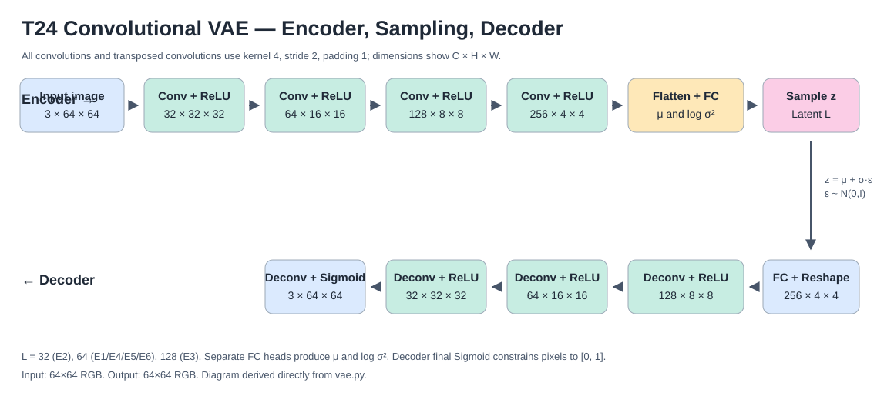

# Person 1 — VAE Architecture & Implementation

**Grounded in the repository source:** [`vae.py`](../vae.py) and [`train_vae.py`](../train_vae.py).



## 1. Encoder: 64×64 RGB → Gaussian latent vector

The four convolutions use kernel size **4**, stride **2**, padding **1**, followed by **ReLU**. Shapes are `channels × height × width` (batch axis omitted).

| Layer | PyTorch operation | Output shape | Parameters |
|---|---|---|---:|
| Input | RGB image | 3×64×64 | 0 |
| Conv1 | Conv2d(3,32,4,2,1) + ReLU | 32×32×32 | 1,568 |
| Conv2 | Conv2d(32,64,4,2,1) + ReLU | 64×16×16 | 32,832 |
| Conv3 | Conv2d(64,128,4,2,1) + ReLU | 128×8×8 | 131,200 |
| Conv4 | Conv2d(128,256,4,2,1) + ReLU | 256×4×4 | 524,544 |
| Flatten | Flatten(start_dim=1) | 4096 | 0 |
| Mean head | Linear(4096,L) | μ: L | 4097L |
| Log-variance head | Linear(4096,L) | log σ²: L | 4097L |

The independent fully connected heads parameterize `q(z|x) = N(μ(x), diag(exp(log σ²(x))))`, not a deterministic encoder output. L is the latent dimension: **32, 64 or 128** across the experiments.

## 2. Reparameterization trick

The implemented formula is:

```python
std = torch.exp(0.5 * logvar)
epsilon = torch.randn_like(std)
z = mean + epsilon * std
```

By sampling noise independently and transforming it using learned parameters, gradients can flow through the encoder. During training the VAE uses sampled `z`. For deterministic visualization and linear-probe classification, the experiments use the encoder's posterior mean `μ`.

## 3. Decoder: latent vector → 64×64 RGB

The fully connected layer maps `L` to `256×4×4` and all transposed convolutions use kernel **4**, stride **2**, padding **1**, output padding **0**.

| Layer | PyTorch operation | Output shape | Parameters |
|---|---|---|---:|
| Input | Latent z | L | 0 |
| FC + reshape | Linear(L,4096) | 256×4×4 | 4096L + 4096 |
| Deconv1 | ConvTranspose2d(256,128,4,2,1) + ReLU | 128×8×8 | 524,416 |
| Deconv2 | ConvTranspose2d(128,64,4,2,1) + ReLU | 64×16×16 | 131,136 |
| Deconv3 | ConvTranspose2d(64,32,4,2,1) + ReLU | 32×32×32 | 32,800 |
| Deconv4 | ConvTranspose2d(32,3,4,2,1) + Sigmoid | 3×64×64 | 1,539 |

The final Sigmoid constrains the output to **[0,1]**, matching the input normalization from raw 0–255 RGB images.

## 4. VAE losses — exact definitions in `vae.py`

```text
Reconstruction = mean_batch[ sum_pixels( (x_hat - x)^2 ) ]
KL = -0.5 * mean_batch[
        sum_latent(1 + logvar - mean^2 - exp(logvar))
     ]
VAE Loss = Reconstruction + beta * KL
```

**Important:** Reconstruction above is squared error **summed over 3×64×64 = 12,288 pixels per image**, then averaged over the batch, not per-pixel MSE. It equals the Gaussian NLL with fixed variance 0.5 *up to an additive constant*. The study separately computes per-pixel validation MSE from `decoder(mean)`, while its Negative ELBO reconstruction uses sampled `z`; they need not match exactly.

## 5. Number of learnable parameters

Calculated from the exact layer definitions including bias terms.

| Latent dimension | Encoder | Decoder | Total |
|---:|---:|---:|---:|
| 32 | 952,352 | 825,059 | **1,777,411** |
| 64 | 1,214,560 | 956,131 | **2,170,691** |
| 128 | 1,738,976 | 1,218,275 | **2,957,251** |

## 6. Baseline run / deliverables

- **Code:** [`vae.py`](../vae.py) includes Encoder, Decoder, VAE, reparameterization and loss.
- **Baseline training script:** [`train_vae.py`](../train_vae.py): L=64, beta=1, 20 epochs, batch=128, learning rate=0.001, seed=42, and checkpoint resume.
- **Original baseline record:** [`results/baseline`](../results/baseline/), with recorded validation metrics and checkpoint metadata. This original baseline is a *separate training run* from the ablation experiment E1.
- **Original six-experiment notebook:** [`results/T24_VAE_Experiments.ipynb`](../results/T24_VAE_Experiments.ipynb).
- **Large model checkpoints:** stored in [Google Drive](https://drive.google.com/drive/folders/13Dd6eMQw5WgDvtS75a2h4Qf71xs8T7A5), not uploaded to Git.

**Discussion point:** The encoder compresses spatial information; the independent heads define a probabilistic representation; reparameterization enables backpropagation; the decoder reconstructs color images; the KL regularizes the posterior. The experiment reconstructions are blurred at a fine-detail level, which is compatible with a pixel-MSE-trained VAE but should be acknowledged.
