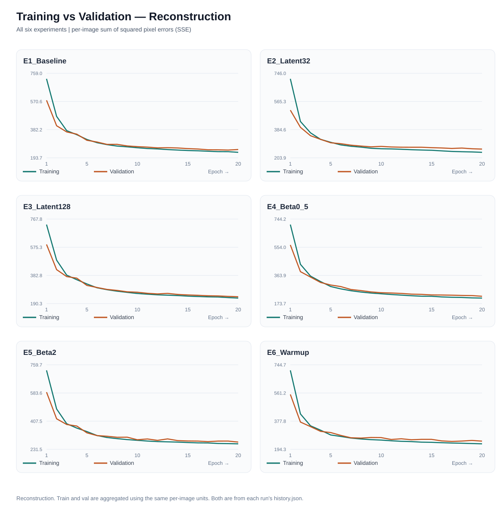
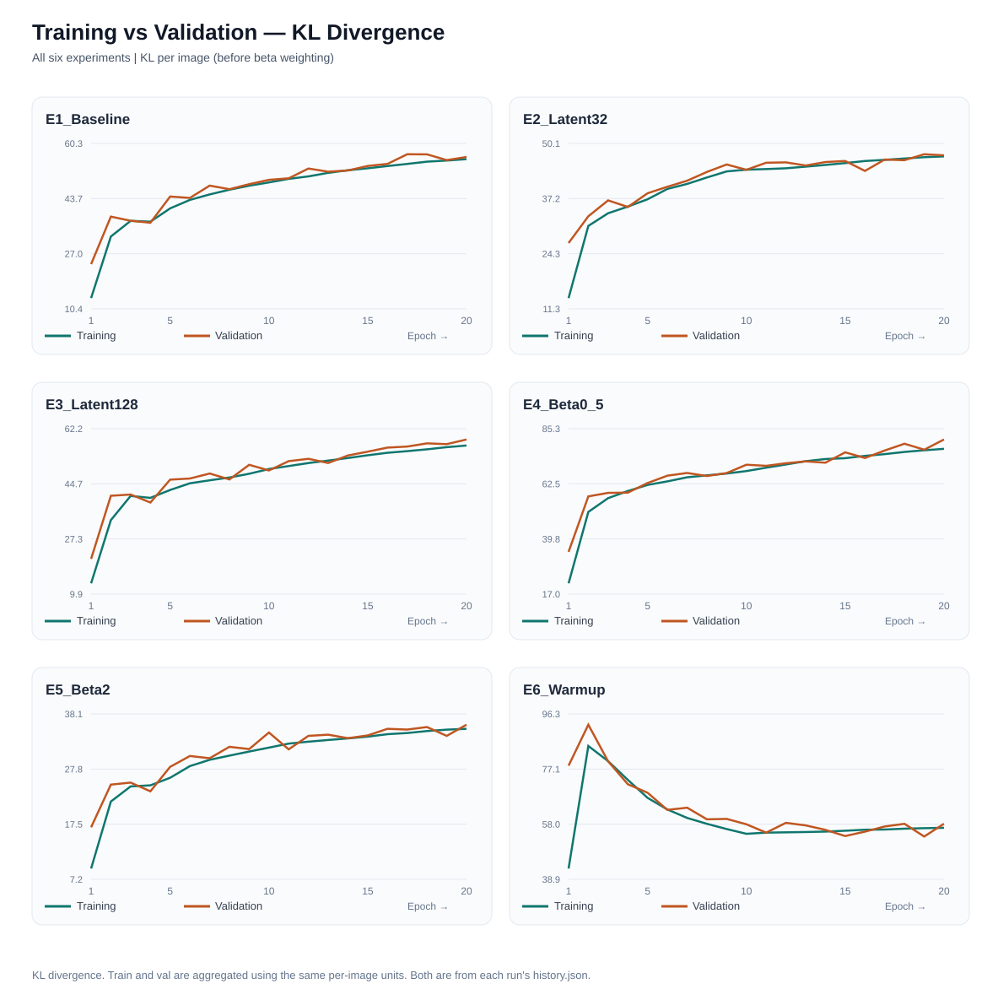

# Person 2 — VAE Experiments & Evaluation Submission

**Study completed:** six controlled VAE runs, each **20 epochs**. Code and epoch-by-epoch records are archived. The input was 64×64 RGB, with 11,529 training images and 1,281 validation images. All model selection is based on the validation split; test data were not used for this choice.

## 1. Experimental design and controls

All runs share Adam optimizer, learning rate **0.001**, batch **128**, seed **42**, identical train/validation splits, and 20 epochs. Every run starts with a fresh model and changes **exactly one factor relative to E1**.

| Experiment | Latent dimension | Training beta | KL warm-up | What changes compared with E1 |
|---|---:|---:|---|---|
| E1 Baseline | 64 | 1.0 | Off | Reference |
| E2 Latent32 | 32 | 1.0 | Off | Latent dim ↓ |
| E3 Latent128 | 128 | 1.0 | Off | Latent dim ↑ |
| E4 Beta0_5 | 64 | 0.5 | Off | Beta ↓ |
| E5 Beta2 | 64 | 2.0 | Off | Beta ↑ |
| E6 Warmup | 64 | 1.0 | On | Linear warm-up of beta over first 10 epochs |

In E6 the effective beta takes the values 0.1, 0.2, …, 1.0 for epochs 1–10, then remains 1.0 through epoch 20.

## 2. Metrics — mathematical and computational meanings

- **Validation reconstruction error:** per-image SSE summed across all 12,288 RGB pixels, averaged across validation images; reconstruction is produced from sampled posterior `z`.
- **Validation KL divergence:** mean KL of `q(z|x)` relative to standard-normal prior `N(0,I)`, averaged across validation images.
- **Comparable negative ELBO:** `reconstruction + 1.0 × KL` at validation, with beta **always 1** even when the **training** beta differs.
- **Pixel MSE:** summed per-pixel squared error divided by `3×64×64`, using deterministic `decoder(μ(x))`. Therefore it is not necessarily reconstruction SSE divided by 12,288 in the same epoch.
- **Active latent units:** count of dimensions with validation-set variance of posterior mean `Var_x(μ_j(x)) > 0.01`.
- **Training time:** sum of logged training+validation epoch-loop times, not full notebook session wall time.
- **GPU memory:** highest allocated CUDA memory during training+validation across all 20 epochs, measured in MiB.

## 3. Final comparison (same 20-epoch budget)

| Experiment | VAL MSE ↓ | VAL Recon SSE ↓ | VAL KL | Negative ELBO at beta=1 ↓ | Active units | Time (seconds) | Peak GPU (MiB) |
|---|---:|---:|---:|---:|---:|---:|---:|
| E1 Baseline | 0.018563 | 249.324 | 56.249 | 305.572 | 61/64 | 66.51 | 153.66 |
| E2 Latent32 | 0.020070 | 259.918 | 47.332 | 307.249 | 32/32 | 60.59 | 149.05 |
| **E3 Latent128** | **0.017414** | **236.923** | **58.754** | **295.677** | **124/128** | **58.42** | **162.87** |
| E4 Beta0_5 | **0.017229** | **223.042** | 80.843 | 303.885 | 64/64 | 56.63 | 153.66 |
| E5 Beta2 | 0.020310 | 276.825 | 36.117 | 312.942 | 64/64 | 57.24 | 153.66 |
| E6 Warmup | 0.018536 | 247.711 | 58.150 | 305.861 | 60/64 | 56.87 | 153.66 |

See [comparison CSV](../results/experiment_comparison.csv) for machine-readable values and [original predictions](../results/predictions.md) for predictions committed before E2–E6 (E1 was already run when the hypotheses were recorded).

## 4. Training and validation figures

Each graph below contains all **six models** split into separate panels, with **Training** and **Validation** data shown together.

Other figures:

- [All six validation reconstruction curves](../results/plots/validation_reconstruction.svg)
- [All six validation KL curves](../results/plots/validation_kl.svg)
- [All six comparable validation negative ELBO curves](../results/plots/validation_negative_elbo.svg)
- [Zoomed ELBO for epochs 10–20](../results/plots/validation_negative_elbo_epochs10to20.svg)

**Fairness note:** E4 and E5 use beta 0.5 and 2 during training, respectively, so their raw training objective cannot be compared directly to beta=1 runs. Compare each run's **common-beta validation negative ELBO** instead.

## 5. Interpretation

**Latent dimension:** reducing the latent size from 64 to 32 (E2) produced worse MSE; increasing it to 128 (E3) lowered MSE and negative ELBO but increased GPU memory. E3 gave the lowest comparable negative ELBO.

**Beta:** beta=0.5 (E4) gave **best pixel MSE and sampled reconstruction SSE** but higher KL (80.84). Beta=2 (E5) reduced KL (36.12) but worsened reconstruction. This is the expected reconstruction/regularization trade-off for these one-seed experiments.

**KL warm-up:** E6's validation MSE was close to E1, its negative ELBO slightly worse, and its active units 60/64 compared with E1's 61/64. The warm-up schedule did **not** demonstrate a meaningful advantage under these conditions.

## 6. Model choice and posterior collapse

**Recommended for subsequent analysis: E3 (latent dimension 128).** Its validation negative ELBO **295.677** is lowest across the six runs at epoch 20. E4 has the lowest MSE but noticeably larger KL and therefore a worse beta=1 negative ELBO.

- E3 saved checkpoint: [Google Drive](https://drive.google.com/file/d/1RvYug7dPSXC1YuVNoEC67lg2w_yTJDc7/view)
- Qualitative comparison: [E3 vs E4 reconstructions](https://drive.google.com/file/d/1TsbPtCPc1NcFqxHNxqn0OKpaFdexHd-r/view)
- The pictures from E3 and E4 preserve broad layout and colors but are visibly blurred and lack fine detail; E4 looks slightly better in some examples.

**Posterior collapse discussion:** Full posterior collapse would typically show very low KL and very few active dimensions, suggesting that the decoder ignores most of `z`. Here all six runs have KL above 36 and mostly active dimensions. That **does not indicate complete collapse**. Still, a few dimensions of E1/E3/E6 are inactive by the chosen threshold; dimensional use can vary. Additional per-dimension KL checks would be needed to rule out partial collapse.

## 7. Project integration evidence (beyond this person's required scope)

A preliminary **frozen-encoder linear probe** used E3's 128 posterior-mean features with standardization and logistic regression, producing **47.54% validation accuracy** versus **42.86%** for E4. That supports E3 for this particular probe but is *not required* by the person's experiment checklist. Exact alignment between image row order and `metadata.csv` label order has **not been independently verified**, so these scores are preliminary until that is checked. See [classification comparison](../results/classification/E3_vs_E4_linear_probe_preliminary.md).

## 8. Caveats and submission integrity

1. Every experiment was trained once, using one seed and a fixed 20-epoch budget, so avoid strong statistical claims for small differences.
2. ELBO evaluation uses sampled `z`; rerunning evaluation can change the value slightly. Pixel MSE uses deterministic `μ` decoding.
3. Time is only the logged epoch-loop total; changing Colab resource conditions can affect speed.
4. This report and the original Colab notebook document completed experiments. A **separate reconstructed runner** exists for repeatability and needs its own smoke/full-reproduction verification; do not claim it produced the archived experimental results.
5. Keep the held-out test split untouched until final model evaluation is locked.

**Source:** [Original six-run Colab notebook](../results/T24_VAE_Experiments.ipynb), [each run's JSON history](../results/), [full analysis report](../results/analysis_report.md).
