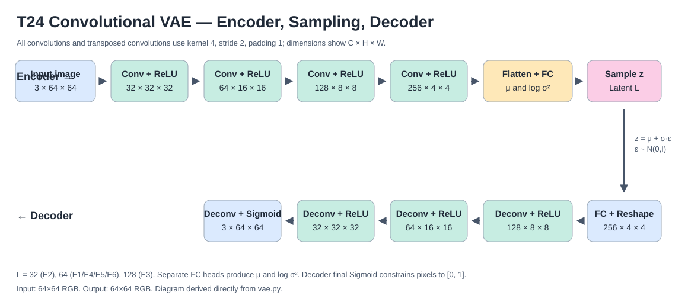

# VAE Architecture

The model is a convolutional Variational Autoencoder implemented in PyTorch. It receives a 64 × 64 RGB image and reconstructs an image of the same size. The encoder estimates a Gaussian latent distribution, and the decoder maps samples from that distribution back into image space.

## Encoder

Four convolutional layers downsample the image from 64 × 64 to 4 × 4 while increasing the number of feature channels. All use a 4 × 4 kernel, stride 2, padding 1, and ReLU activation.

| Layer | Operation | Output shape |
|---|---|---|
| Input | RGB image | 3 × 64 × 64 |
| Conv 1 | 3 → 32 channels | 32 × 32 × 32 |
| Conv 2 | 32 → 64 channels | 64 × 16 × 16 |
| Conv 3 | 64 → 128 channels | 128 × 8 × 8 |
| Conv 4 | 128 → 256 channels | 256 × 4 × 4 |
| Flatten | Flatten feature maps | 4,096 |
| Fully connected | Mean (μ) | Latent dimension |
| Fully connected | Log-variance (log σ²) | Latent dimension |

The mean and log-variance are produced by two independent linear layers. The experiments use latent dimensions of 32, 64, and 128.

## Reparameterization

The encoder models the approximate posterior as a diagonal Gaussian distribution. To sample from it while allowing gradients to flow through the encoder, the model uses:

`z = μ + exp(0.5 × log σ²) × ε`, where `ε ~ N(0, I)`.

The implementation is in [vae.py](../vae.py).

## Decoder

The decoder first projects the latent vector to 4,096 values, reshapes them to 256 × 4 × 4, and then upsamples through four transposed convolutional layers. Their kernel size, stride, and padding are also 4, 2, and 1.

| Layer | Operation | Output shape |
|---|---|---|
| Fully connected + reshape | Latent → 4,096 values | 256 × 4 × 4 |
| Transposed Conv 1 + ReLU | 256 → 128 channels | 128 × 8 × 8 |
| Transposed Conv 2 + ReLU | 128 → 64 channels | 64 × 16 × 16 |
| Transposed Conv 3 + ReLU | 64 → 32 channels | 32 × 32 × 32 |
| Transposed Conv 4 + Sigmoid | 32 → 3 channels | 3 × 64 × 64 |

The final Sigmoid produces reconstructed pixel values between 0 and 1, matching the image normalization used during training.

## Loss function

The reconstruction loss is the sum of squared pixel differences per image, averaged across the batch:

`L_recon = mean_batch[ Σ_pixels (x − x̂)² ]`

The KL divergence compares the learned posterior with the standard normal prior:

`L_KL = −0.5 × mean_batch[ Σ_latent (1 + log σ² − μ² − exp(log σ²)) ]`

The complete objective is:

`L_VAE = L_recon + β × L_KL`

Reconstruction loss uses a sampled latent vector during training. The validation pixel MSE reported in the experiments is calculated separately using the decoder output from the posterior mean.

## Baseline training

The initial model used latent dimension 64, β = 1, batch size 128, learning rate 0.001, and 20 epochs with Adam. The baseline script is [train_vae.py](../train_vae.py); the implementation is [vae.py](../vae.py). Its recorded evaluation is stored under [results/baseline](../results/baseline/), and the model checkpoint is [on Google Drive](https://drive.google.com/file/d/1US8y1jP3kFUNhqHgGHwFSbYWOc4yca17/view).

The initial baseline run and experiment E1 are separate runs.
