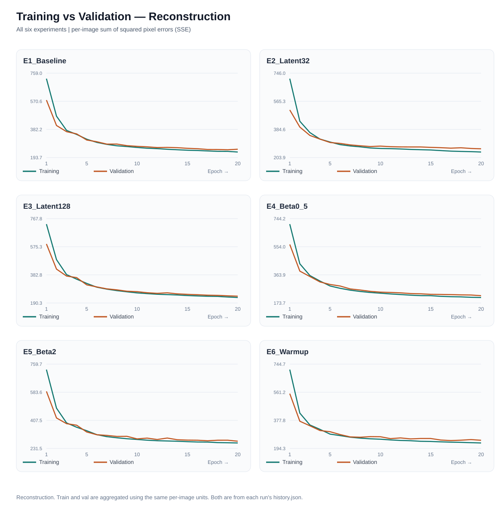
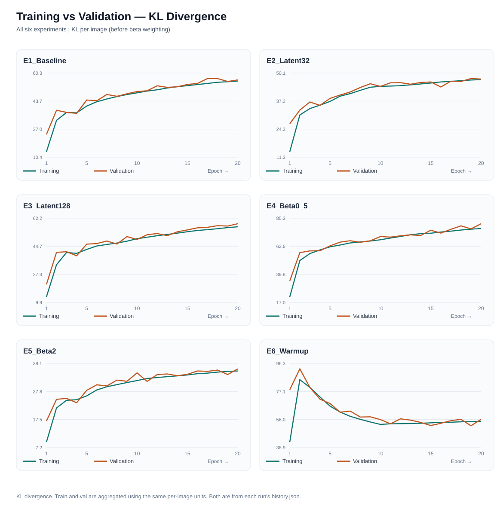

# VAE Experiments and Evaluation

Six VAE configurations were trained on a 10-class ImageNet subset of 64 × 64 RGB images. The training split contains 11,529 images and the validation split contains 1,281. Each experiment used 20 epochs, batch size 128, Adam with learning rate 0.001, and seed 42.

The baseline configuration is a 64-dimensional latent space with β = 1 and no KL warm-up. Each other experiment changes one setting relative to this baseline.

## Experimental settings

| Experiment | Latent dimension | β during training | KL warm-up |
|---|---:|---:|---|
| E1 — Baseline | 64 | 1.0 | Off |
| E2 — Latent 32 | 32 | 1.0 | Off |
| E3 — Latent 128 | 128 | 1.0 | Off |
| E4 — Beta 0.5 | 64 | 0.5 | Off |
| E5 — Beta 2 | 64 | 2.0 | Off |
| E6 — KL warm-up | 64 | 1.0 | First 10 epochs |

For E6, the effective β increased from 0.1 in epoch 1 to 1.0 in epoch 10 and remained at 1.0 thereafter.

## Evaluation

Reconstruction error and KL divergence were measured on the validation set after each epoch. The negative ELBO used for comparing experiments is `reconstruction + KL`, with β fixed to **1** for evaluation even when a different β was used in training.

Validation MSE is calculated from deterministic reconstructions using the posterior mean. Active latent units are the dimensions for which the variance of encoder means over the validation images exceeds 0.01. Reported time is the sum of training and validation epoch times; GPU memory is peak allocated CUDA memory.

## Results after 20 epochs

| Experiment | Validation MSE ↓ | Reconstruction ↓ | KL | Negative ELBO (β=1) ↓ | Active units | Time (s) | Peak GPU (MiB) |
|---|---:|---:|---:|---:|---:|---:|---:|
| E1 | 0.01856 | 249.32 | 56.25 | 305.57 | 61/64 | 66.51 | 153.66 |
| E2 | 0.02007 | 259.92 | 47.33 | 307.25 | 32/32 | 60.59 | 149.05 |
| **E3** | **0.01741** | **236.92** | **58.75** | **295.68** | **124/128** | **58.42** | **162.87** |
| E4 | **0.01723** | **223.04** | 80.84 | 303.89 | 64/64 | 56.63 | 153.66 |
| E5 | 0.02031 | 276.82 | 36.12 | 312.94 | 64/64 | 57.24 | 153.66 |
| E6 | 0.01854 | 247.71 | 58.15 | 305.86 | 60/64 | 56.87 | 153.66 |

The exact measurements are available in [experiment_comparison.csv](../results/experiment_comparison.csv), with epoch-by-epoch histories stored in the corresponding experiment folders.

## Training and validation curves

The combined [validation negative ELBO](../results/plots/validation_negative_elbo.svg) and [validation reconstruction](../results/plots/validation_reconstruction.svg) curves show the six experiments on common axes.

## Discussion

Reducing the latent size to 32 (E2) increased reconstruction error, while increasing it to 128 (E3) improved both reconstruction and negative ELBO. The larger latent space used more GPU memory.

Reducing β to 0.5 (E4) gave the lowest reconstruction MSE and the highest KL. Increasing β to 2 (E5) reduced KL but produced worse reconstructions. This shows the trade-off between reconstructing image details and regularizing the latent distribution.

KL warm-up (E6) produced results close to the baseline: its validation negative ELBO was 305.86 compared with 305.57 for E1. No clear improvement was observed in this run.

**E3 (latent dimension 128) was selected** because it achieved the lowest validation negative ELBO, **295.68**, after the same 20-epoch training budget. E4 had slightly lower MSE but a considerably higher KL, giving it a worse negative ELBO under the common evaluation criterion.

## Posterior collapse

Posterior collapse can occur when the approximate posterior approaches the prior and the decoder makes little use of the latent variables. Typical signs are KL values approaching zero and few active latent units. All six experiments showed substantial KL and mostly active dimensions, so there was no evidence of *complete* posterior collapse. A few dimensions were inactive in some configurations, which means partial underuse cannot be ruled out.

The reconstructions retain broad shapes and colors but lose fine details. The [E3 and E4 reconstruction comparison](https://drive.google.com/file/d/1TsbPtCPc1NcFqxHNxqn0OKpaFdexHd-r/view) illustrates this. The comparison is based on one run per configuration; small differences should not be treated as statistically conclusive.

The original training notebook is [T24_VAE_Experiments.ipynb](../results/T24_VAE_Experiments.ipynb). The selected [E3 checkpoint](https://drive.google.com/file/d/1RvYug7dPSXC1YuVNoEC67lg2w_yTJDc7/view) is stored on Google Drive.
