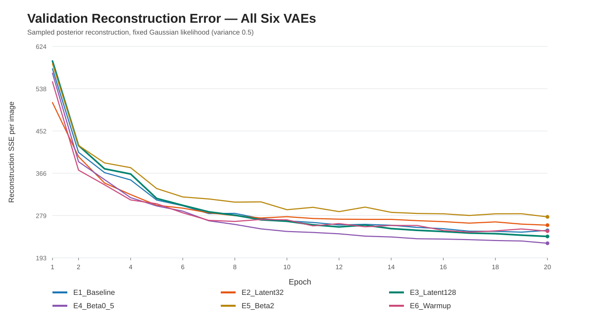
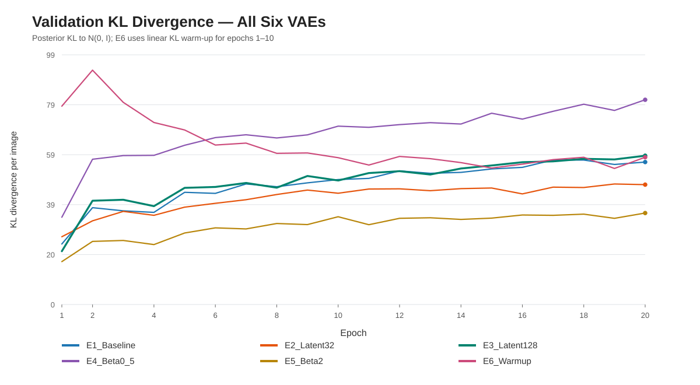
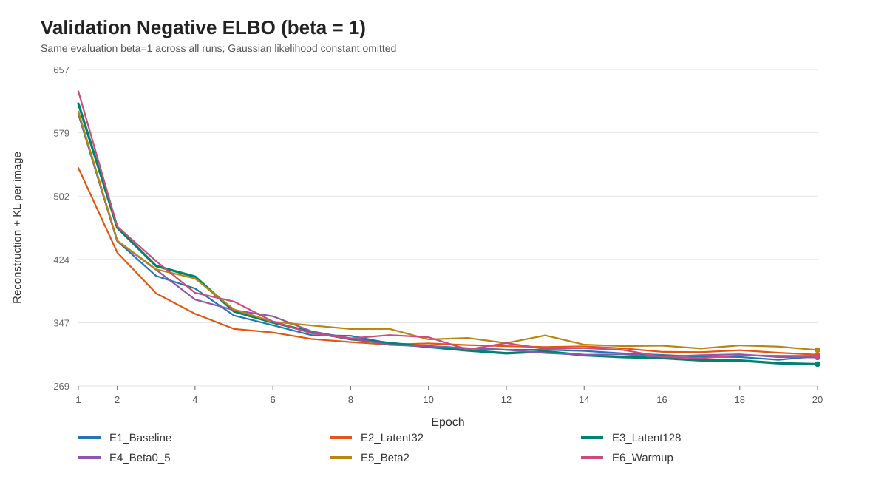

# Six-run VAE ablation study — Results and interpretation

**Team:** T24  
**Scope:** 10-class ImageNet subset, 64×64 RGB, convolutional VAE trained from scratch in PyTorch.  
**Status:** All six runs completed (20 training epochs each).  
**Selection rule:** Compare **epoch-20 validation negative ELBO evaluated with beta=1**. This is a single-run comparison; the final choice should be confirmed with fixed-seed repeated validation and, if feasible, multiple training seeds.

## Experimental controls

All runs use the same dataset split (11,529 train / 1,281 validation images), architecture except for explicitly changed latent dimension, Adam with learning rate 0.001, batch size 128, training seed 42, and 20 epochs. Beta values are `1` in E1–E3 and E6, `0.5` in E4, `2` in E5. E6 ramps effective KL weight linearly `0.1, 0.2, …, 1.0` in epochs 1–10 and holds at 1.0 thereafter. Every run was initialized as a new model.

**One factor changes relative to E1 per run:** E2 latent 32; E3 latent 128; E4 beta 0.5; E5 beta 2; E6 KL warm-up enabled.

The reconstruction loss is summed squared pixel error per image, averaged across the batch, equivalent to a Gaussian negative log-likelihood with fixed variance 0.5 **up to a constant**. KL is against an independent standard normal prior. Validation negative ELBO reported here is **reconstruction + KL** with beta forced to **1** regardless of training beta. Pixel-wise validation MSE is calculated from `decoder(posterior_mean)` and can differ from the posterior-sampled reconstruction term used for ELBO. Results use the same last epoch (epoch 20) to keep training budgets equal.

## Final results — epoch 20

| Run | Latent | Train beta | Warm-up | VAL pixel MSE ↓ | VAL reconstruction ↓ | VAL KL | VAL negative ELBO (beta=1) ↓ | Active units | Epoch-loop time (s) | Peak GPU allocated (MiB) |
|---|---:|---:|---|---:|---:|---:|---:|---:|---:|---:|
| E1_Baseline | 64 | 1 | Off | 0.018563 | 249.324 | 56.249 | 305.572 | 61/64 | 66.51 | 153.66 |
| E2_Latent32 | 32 | 1 | Off | 0.020070 | 259.918 | 47.332 | 307.249 | 32/32 | 60.59 | 149.05 |
| **E3_Latent128** | **128** | **1** | **Off** | **0.017414** | **236.923** | **58.754** | **295.677** | **124/128** | **58.42** | **162.87** |
| E4_Beta0_5 | 64 | 0.5 | Off | **0.017229** | **223.042** | 80.843 | 303.885 | 64/64 | 56.63 | 153.66 |
| E5_Beta2 | 64 | 2 | Off | 0.020310 | 276.825 | 36.117 | 312.942 | 64/64 | 57.24 | 153.66 |
| E6_Warmup | 64 | 1 | On | 0.018536 | 247.711 | 58.150 | 305.861 | 60/64 | 56.87 | 153.66 |

Metrics are read from each run's committed `history.json`; machine-readable table: [experiment_comparison.csv](experiment_comparison.csv).

### Figures

- [Validation reconstruction curves](plots/validation_reconstruction.svg)
- [Validation KL curves](plots/validation_kl.svg)
- [Validation negative ELBO, 20 epochs](plots/validation_negative_elbo.svg)
- [Validation negative ELBO, zoom epochs 10–20](plots/validation_negative_elbo_epochs10to20.svg)

## Predictions versus observations

Hypotheses were **committed before E2–E6**, but **E1 had already been trained**; see [predictions.md](predictions.md). These statements explain observed trends from *one run per configuration* and should not be interpreted as guaranteed effects.

- **E2 (latent 32):** Predicted worse reconstruction. **Observed:** pixel MSE rose to 0.020070 (vs 0.018563 in E1), KL dropped to 47.33. Hypothesis supported for this run.
- **E3 (latent 128):** Predicted better reconstruction with potentially higher memory. **Observed:** MSE improved to 0.017414 and allocated memory increased to 162.87 MiB. Hypothesis supported for this run.
- **E4 (beta 0.5):** Predicted improved reconstruction but larger KL. **Observed:** best pixel MSE (0.017229) and lowest reconstruction SSE (223.04), but higher KL (80.84). Hypothesis supported for this run.
- **E5 (beta 2):** Predicted reduced KL at the cost of reconstruction. **Observed:** KL reduced to 36.12 but MSE increased to 0.020310; comparable negative ELBO worsened to 312.94. Hypothesis supported for this run.
- **E6 (10-epoch KL warm-up):** Predicted improved use of latent space and possibly lower risk of collapse. **Observed:** last-epoch active units **60/64**, compared with **61/64** in E1, and comparable negative ELBO **305.86** vs **305.57**. No meaningful improvement from warm-up was demonstrated in this setting. The early epochs showed high KL (78.33 at epoch 1 and 92.54 at epoch 2) while the KL penalty was still low, then KL decreased as the beta weight increased.

## Selection: E3 for the next stages

**Recommended VAE from this study: E3_Latent128.** At epoch 20 it produced the lowest comparable validation negative ELBO (**295.677**) of all six configurations and the second-lowest pixel MSE (**0.017414**). It uses 124/128 active units by the defined threshold.

**Why not E4?** E4 gives the best pixel MSE (**0.017229**) and reconstruction SSE (**223.04**) but has substantially higher KL (**80.84**) and therefore worse negative ELBO (**303.885**) under the common beta=1 evaluation criterion. E4 is a useful secondary checkpoint for qualitative reconstruction comparisons.

The selected weights are in the **E3 epoch-20 checkpoint** on [Google Drive](https://drive.google.com/file/d/1RvYug7dPSXC1YuVNoEC67lg2w_yTJDc7/view). To load with the repository's `vae.py`, instantiate `VAE(latent_dim=128)`, read the checkpoint with PyTorch, and load `ckpt["model_state"]`. The dataset and checkpoints remain on Drive rather than in Git because of size.

## Qualitative reconstruction check: E3 versus E4

The same six validation images were reconstructed with the posterior-mean decoding `decoder(mu(x))` from the saved epoch-20 checkpoints. See [side-by-side Original / E3 / E4 grid on Google Drive](https://drive.google.com/file/d/1TsbPtCPc1NcFqxHNxqn0OKpaFdexHd-r/view).

**Observation:** Both models reproduce broad composition, foreground/background color regions and some object silhouettes, but lose high-frequency detail (faces, fine edges, texture). E4 often shows somewhat better object shape definition and color contrast in these six examples (notably the dark footwear), although the differences are modest and image-dependent; neither output is photorealistically sharp. This aligns with E4's marginally lower validation pixel MSE (**0.017229** versus E3's **0.017414**) but is not a blinded perceptual evaluation. **E3 remains the selected model by the declared negative-ELBO criterion**, while E4 can be kept as a supplementary reconstruction-focused comparison.

The dataset's `metadata.csv` lists `image_name,image_path,synset,label` with **12,810 rows** and **10 class labels (0–9)**; the feature-classification evaluation should use `train_indices.npy` and `val_indices.npy` to align rows and avoid leakage. Do not use the reserved test set for model selection.

## Preliminary classification evaluation: frozen E3 vs E4 encoders

A linear probe was trained separately on the frozen posterior-mean features from E3 (128 features) and E4 (64 features), using the same 11,529 train / 1,281 validation indices and a `StandardScaler` + `LogisticRegression(max_iter=2000)` classifier.

| Metric | E3 | E4 |
|---|---:|---:|
| Validation accuracy | **47.54%** | 42.86% |
| Balanced accuracy | **47.32%** | 42.67% |

E3 leads by **4.68 percentage points** in validation accuracy. This supports choosing E3 for the **current linear-probe task** even though E4 has a slightly lower reconstruction pixel MSE. However, E3 and E4 differ in latent dimension as well as training beta; the classification comparison does not attribute the improvement to one isolated factor. Label/array alignment has yet to be independently verified and the classifier results are user-reported, so these remain **preliminary validation results**, not test results.

See [E3 vs E4 classification details](classification/E3_vs_E4_linear_probe_preliminary.md) and [E3 per-class report](classification/E3_linear_probe_preliminary.md).

## Posterior collapse: concept and evidence

Posterior collapse occurs if the learned approximate posterior `q(z|x)` becomes too similar to the prior `p(z) = N(0,I)` and the decoder learns to ignore the input-dependent latent representation. It is commonly associated with **KL approaching zero** and **few active latent units**, potentially accompanied by poor or generic reconstructions.

In these results, last-epoch aggregate KL ranges from about **36.12 to 80.84**, and all configurations have a high proportion of active units: E1 61/64, E2 32/32, E3 124/128, E4 64/64, E5 64/64, E6 60/64. This provides **no indication of a complete posterior collapse**. However, E1/E3/E6 do contain a handful of *inactive dimensions* under the threshold, and total KL/active-unit counts alone cannot rule out weak use of some dimensions. Dimension-level KL, posterior-mean variance and latent traversal plots would help investigate partial collapse.

**KL warm-up did not prevent an observed collapse here, because the baseline was already not globally collapsed.** It is a regularization schedule tested here, not a guaranteed anti-collapse fix.

## Measurement and methodology caveats

1. **Single training seed** and only 20 epochs; avoid interpreting small differences (especially E1 vs E6) as statistically established.
2. **Stochastic validation reconstruction for the ELBO:** the evaluation draws a fresh posterior sample, so rerunning evaluation can slightly change negative ELBO. Use fixed seeds or repeated posterior samples for a stronger final ranking.
3. **Epoch 20 comparisons:** training budget is fixed, although some runs had lower ELBO earlier; for example E1's lowest *logged* ELBO was epoch 19, and E6's was epoch 17. The saved training checkpoints correspond to epoch 20, so the reported comparison is aligned with available saved weights.
4. **Time and memory:** time is summed from logged per-epoch training plus validation (not total Colab session wall time); memory is peak CUDA **allocated** memory, not peak reserved memory or physical GPU usage. Runtime differences can include hardware load/Colab variation. `MiB = 2^20 bytes`.
5. **Data paths:** the team should verify the dataset's raw storage range and the exact normalization used; the original ablation code divides pixel values by 255. Input data should be raw 0–255 images.
6. **Study runner:** results were trained in Google Colab. The exact original notebook has not been archived in this repository yet; the team should archive it for complete provenance and test any separately reconstructed runner before claiming bitwise reproducibility.

## Next team tasks

- Archive the original Google Colab study notebook and environment versions/commit ID.
- Use E3 encoder for downstream classification and latent-space analysis, then examine latent interpolation and traversals.
- Generate identical-input original-versus-reconstructed image grids for E3 and E4.
- Consider fixed-seed / repeated-sample validation before final model selection, and avoid using the test split for tuning.
- Later extend the repository for GAN, VAE-GAN and full project reporting.
